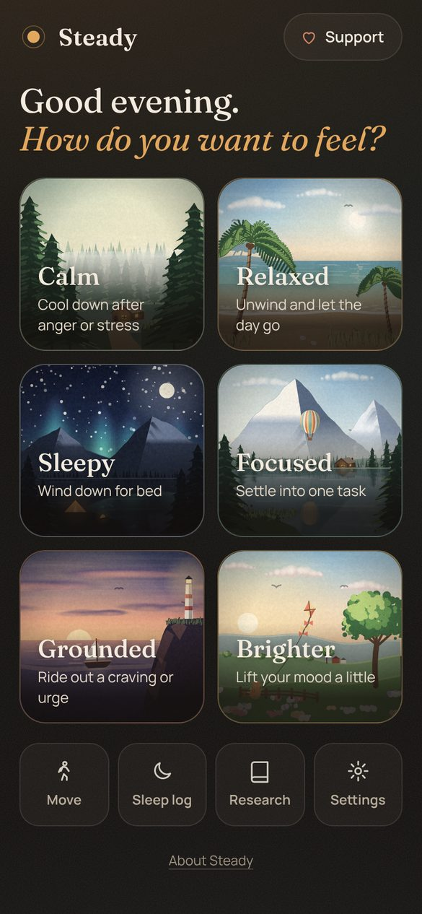
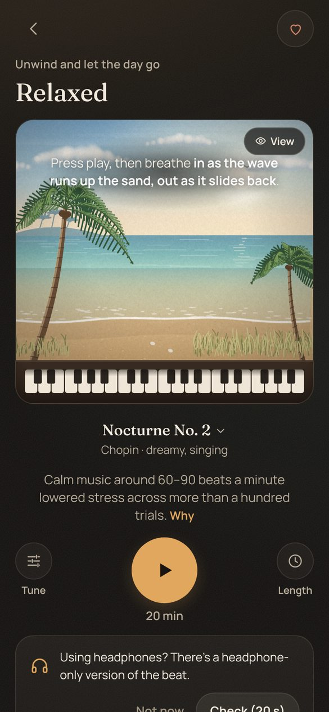
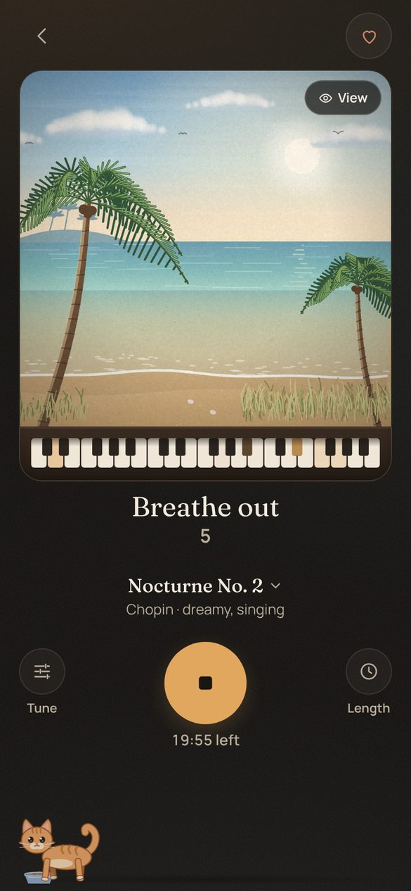

# Steady

A free sound and breathing tool for anyone who wants to calm down, ride out an urge, relax, fall asleep or focus: calm music, paced breathing and an optional soft beat, all in your browser.

### [Open the app →](https://candanumut.github.io/beats/)

Works on your phone; add it to your home screen and it works offline.

<p>
  
  
  
</p>

> This is a wellness and music tool, not a medical device. See [SAFETY.md](SAFETY.md).

## What you get

- **Six moods, one tap each**: Calm, Relaxed, Sleepy, Focused, Grounded (ride out a craving or urge) and Brighter. Each sets up music, breathing pace, beat and length for you.
- **Paced breathing** you can follow: a gentle swell in the music plus a "breathe in / breathe out" cue with a countdown.
- **Real music**: Chopin, Satie, Debussy and Bach on a real piano sound, plus lo-fi, ambient pads, strings, rain and noise, or your own file.
- **Honest evidence**: every part shows how strong the research is, including null and negative results, and a Lab lets you test, blinded, what actually helps you.
- **Safety built in**: a first-run safety screen, help lines one tap away, loudness limits, sleep sessions that fade out, nothing that flashes.

**Private by design**: no account, no server, no analytics. Your settings, logs and check-ins stay on your device (IndexedDB) and you can export them as CSV. Your own music files are decoded on your device and never uploaded. The only thing loaded from the internet is the app itself.

## All the features

- **Guided flows**: Calm down (step away, then breathing, then calm music), Ride an urge (15-minute urge-surfing timer with prompts and check-ins), Relax, Sleep wind-down (fades out on its own), Focus blocks, Breathe practice (slow breathing or cyclic sighing), Movement break.
- **Music library**: 16 classical piano pieces (Chopin nocturnes and preludes, Satie, Debussy, Bach) played from free scores on a real upright-piano sound, an endless generated piano piece, lo-fi chill, ambient pads, warm strings, a music box, rain and noise, or your own file (decoded locally, never uploaded).
- **Animations**: a piano with notes drifting onto softly glowing keys, or four gently vibrating strings, synced to the notes. Slow, no flashing.
- **Sound engine**: breathing swell, loudness normalized to −20 LUFS, true-peak limiter at −1 dBTP, WAV export.
- **Experiment Lab**: test one part at a time (binaural beat vs sham, pulse vs sham, breathing guide on/off, sound A vs B). Locked plan, hidden randomized blocks of 4 (ABBA/BAAB), before/after ratings, optional 2-minute reaction-time test, condition guesses, results only at the end: paired difference with 95% CI, permutation test, blinding accuracy and a plain verdict.
- **Beats (experimental)**: binaural (headphones) or a power-matched pulse (speakers), tuned to the key of the music. On by default in every mood, including Calm and Grounded (the owner's choice); switch it off for any mood in Tune. See [SAFETY.md](SAFETY.md) for why you might want to in Calm and Grounded.
- **Works offline** as a PWA.
- **Evidence badges** on every goal, with "Why?" pages that include null and negative results. Myths page.
- **Safety**: first-run safety screen, left/right and stereo checks, level calibration, help lines, weekly listening log, gentle nudges toward real support. Nothing flashes.
- **Private**: no server, no accounts, no analytics. Data lives in IndexedDB on your device, with CSV export.

## Run it yourself

```bash
npm install
npm run dev        # local dev server
npm test           # unit tests (audio math, loudness, banned words, stats)
npm run build      # type-check + production build into dist/
npm run screenshots  # Playwright screenshots at 390 px and desktop
```

Audio checks in Python (optional): `pip install numpy scipy soundfile pyloudnorm`, then `python tools/verify_wav.py <file.wav>`.

## How it's built

- TypeScript + Vite + Preact. No backend.
- All DSP lives in `src/audio/dsp/` as plain TypeScript. The same `SessionMixer` runs in an AudioWorklet (live), in a Worker (WAV export), and in the unit tests, so what you hear, what you export and what is tested is the same code.
- Evidence comes from [docs/RESEARCH.md](docs/RESEARCH.md); see [EVIDENCE.md](EVIDENCE.md).

## License

Code: MIT (see [LICENSE](LICENSE)). Built-in sounds are generated by this project's code; the piano samples, music scores and cat sounds come from free sources listed with their licenses in [ATTRIBUTION.md](ATTRIBUTION.md).
